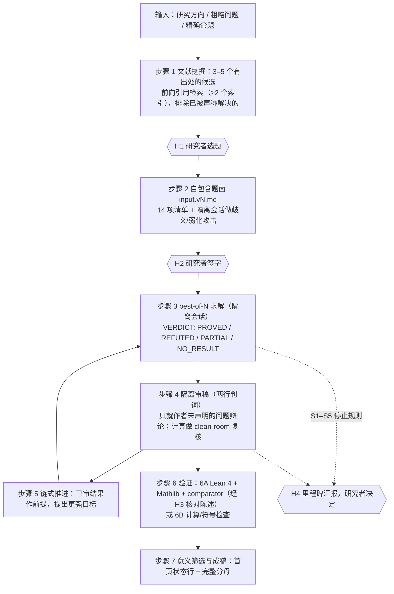
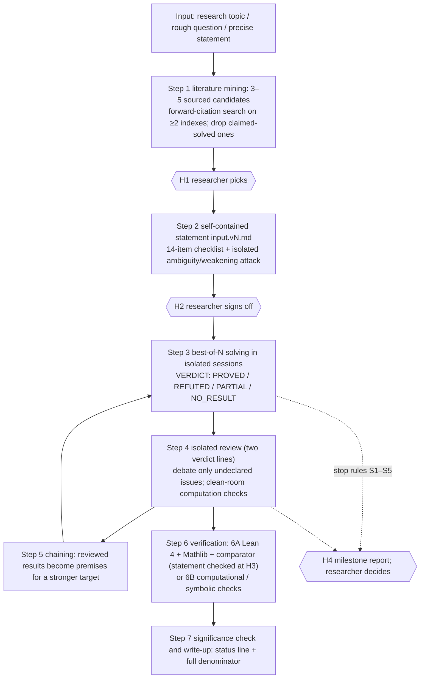

# OpenAI Math Skill

**[中文](#中文) · [English](#english)**

一个面向研究者的 agent 技能（`SKILL.md`）：把一个研究方向（哪怕很模糊）变成有出处的开放问题、签过字的证明/否证题面、独立求解与隔离审稿，以及诚实的状态标签。适用于 OpenAI Codex、Claude Code、Cursor、Gemini CLI、GitHub Copilot，以及任何能读取 Agent Skills 或 `AGENTS.md` 的 AI 编程 agent。

An agent skill (`SKILL.md`) for researchers: it turns a research topic (even a vague one) into sourced open problems, a signed-off prove-or-refute statement, independent solving with isolated review, and honest status labels. Works with OpenAI Codex, Claude Code, Cursor, Gemini CLI, GitHub Copilot, and any AI coding agent that reads Agent Skills or `AGENTS.md`.

> 与 OpenAI 无关联，未获 OpenAI 认可。/ Not affiliated with or endorsed by OpenAI.

---

<a id="中文"></a>

## 中文

### 一段话介绍

你给 agent 一个研究方向、一个粗略的问题或一个精确的命题。agent 先查文献，交付 3–5 个**出处已逐条打开核对**、并检查过"是否已被声称解决"的候选问题；只问会改变命题的关键问题（每轮 ≤3 个，其余用默认值）；写出自包含的 prove-or-refute 题面，等你明确签字；然后在**彼此隔离的会话**里做 best-of-N 求解，用只看题面和成稿的隔离审稿人审稿，能形式化的用 Lean 4 + [comparator](https://github.com/leanprover/comparator) 验收，不能形式化的做 clean-room 计算复核；最后给出一个说清"验证了什么、没验证什么"的状态标签。失败也会完整记录分母。

### 为什么做这个

- [openai/math](https://github.com/openai/math) 公开了内部模型产出的数学手稿（当前目录为 719 篇、372 个家族；README 称模型共被问了约 4,000 道题，每个结果平均用了约三小时 ChatGPT Pro 思考算力），附带推理摘要、提示摘录和验证附件。它展示的要点是：**杠杆在题面**（长而精确的题面，几乎都在消歧、堵捷径）、多次独立尝试、独立审核、形式化验收。
- 但**完整提示词从未公开**（《科学美国人》报道："…and no prompts"）。本仓库的模板和流程默认值是我们根据公开摘录、First Proof 第二批报告和 OpenAI 博客做的**重构**，不是 OpenAI 原文，也不是其实际 harness。逐字引用只出现在 `SKILL.md` 附录 A，并附出处。
- 目标是一个**与工具无关、可降级**的流程：有多个模型族时做得更严，只有一个模型时也能跑，只是标签上限更低。

### 声明

- **本项目与 OpenAI 无任何关联**，未经 OpenAI 认可或背书。"OpenAI" 只用来指明所重构的公开发布。
- OpenAI 用的是未发布的内部模型。公开模型的产出率要大幅调低：First Proof 报告的预跑中，几个公开模型在 30 分钟超时下十题一题也没解出（`SKILL.md` 附录 A-9）。
- AI 审稿不是同行评审。`REVIEWED(AI 2× same family)` 的意思就是字面意思。

### 工作流程



- **人工停点只有 4 个**：H1 选题、H2 签字、H3 Lean 陈述核对（只在走 Lean 时）、H4 里程碑。研究者离线时，可以事先书面预授权部分停点（`SKILL.md` I-8），但弱化命题、超预算、数据外发许可不能预授权。
- **隔离**有可执行定义（`SKILL.md` §1.1）：全新会话、无历史和记忆、只能读到该角色允许的文件、单 agent（不得派生子 agent）、联网按题面的 SEARCH POLICY。开跑前做一次冒烟检查，用外部证据（工具清单、标记文件、stderr）判定，不信会话自述。
- 审稿输出**两行判词**：`CLAIMED-SCOPE VERDICT`（只判作者声称证明的部分）和 `vs-ASSERTION VERDICT`（作为原题解答来判），所以 PARTIAL 稿件也能得到有意义的审稿结论。

### 快速开始

1. 安装（任选其一，详见下一节）：

   ```bash
   # Codex / Cursor / Gemini CLI / GitHub Copilot 共用的用户级目录
   git clone https://github.com/xi-zhao/openai-math-skill.git ~/.agents/skills/openai-math-skill

   # Claude Code
   git clone https://github.com/xi-zhao/openai-math-skill.git ~/.claude/skills/openai-math-skill
   ```

2. 新开一个工作目录（研究产物会写进 `research/<id>/`），启动你的 agent，直接说：

   ```text
   用 OpenAI Math Skill。我想用 AI 做量子纠错码距离下界方向的研究，先帮我找几个还没解决、能写成证明或否证的问题，给出处。
   ```

   ```text
   Use the OpenAI Math Skill. I'm interested in Sidon sets and B_h sequences. Find me a few open problems I could attack, with verified sources.
   ```

   已有精确命题时：

   ```text
   用 OpenAI Math Skill：证明或否证"对每个整数 n > 1，若 n 整除 2^n − 2，则 n 是素数"。不允许联网检索。
   ```

3. 接下来会发生什么：agent 先做环境自检（能否开隔离会话、几个模型族、能否执行代码、有无 Lean/comparator、能否联网），确定运行档位；问你**花费上限**和**能否把题目发给第三方模型 API**；交付候选并在 H1 停下等你选题；在 H2 给你看完整题面、提示变体、14 项清单结果和预算，等你回复"确认"后才开始求解。

### 按 agent 安装

`SKILL.md` 遵循 [Agent Skills](https://agentskills.io/specification) 开放格式：一个目录 + 目录里的 `SKILL.md`。把整个仓库克隆成技能目录即可（README、LICENSE 等额外文件不影响加载）；也可以只下载 `SKILL.md`。下表路径于 2026-10-08 按各工具官方文档核对。

| Agent | 用户级（所有项目） | 项目级（提交进仓库） | 怎么调用 | 官方文档 |
|---|---|---|---|---|
| **OpenAI Codex**（CLI、IDE 扩展、ChatGPT 桌面版） | `~/.agents/skills/openai-math-skill/SKILL.md` | `.agents/skills/openai-math-skill/SKILL.md`（从当前目录到仓库根逐级扫描） | 按描述自动触发；或 `/skills`、输入 `$` 提及技能 | [Codex skills](https://developers.openai.com/codex/skills) |
| **Claude Code** | `~/.claude/skills/openai-math-skill/SKILL.md` | `.claude/skills/openai-math-skill/SKILL.md` | 自动触发；或 `/openai-math-skill`（目录名即命令名） | [Claude Code skills](https://code.claude.com/docs/en/skills) |
| **Cursor** | `~/.cursor/skills/` 或 `~/.agents/skills/` | `.cursor/skills/` 或 `.agents/skills/` | Agent 自动选用；或在 Agent 聊天里输入 `/` 搜索 | [Cursor Agent Skills](https://cursor.com/docs/context/skills) |
| **Gemini CLI** | `~/.gemini/skills/` 或 `~/.agents/skills/` | `.gemini/skills/` 或 `.agents/skills/` | 自动激活（会弹出确认）；`/skills list` 查看 | [Gemini CLI skills](https://geminicli.com/docs/cli/skills/) |
| **GitHub Copilot**（CLI、云端 agent、VS Code / JetBrains agent 模式、Copilot app） | `~/.copilot/skills/` 或 `~/.agents/skills/` | `.github/skills/`、`.claude/skills/` 或 `.agents/skills/` | 按描述自动选用 | [Adding agent skills](https://docs.github.com/en/copilot/how-tos/use-copilot-agents/cloud-agent/add-skills) |
| **只读 `AGENTS.md` 的 agent**（如 Windsurf、Zed、opencode、Jules、Amp、Aider 等） | — | 在你的项目 `AGENTS.md` 里加一行指向 `SKILL.md`（见下） | agent 读到指引后按需读取 `SKILL.md` | [agents.md](https://agents.md/) |
| **纯聊天界面**（不能读本地文件） | — | — | 把 `SKILL.md` 作为附件上传或粘贴 | — |

**一条命令，覆盖大多数 agent**（Codex、Cursor、Gemini CLI、Copilot 都读 `~/.agents/skills/`；Claude Code 用软链接，官方文档说明支持软链接的技能目录）：

```bash
mkdir -p ~/.agents/skills ~/.claude/skills
git clone https://github.com/xi-zhao/openai-math-skill.git ~/.agents/skills/openai-math-skill
ln -s ~/.agents/skills/openai-math-skill ~/.claude/skills/openai-math-skill   # 仅 Claude Code 需要
```

只要 `SKILL.md`、不要整个仓库：

```bash
mkdir -p ~/.agents/skills/openai-math-skill
curl -fsSL https://raw.githubusercontent.com/xi-zhao/openai-math-skill/main/SKILL.md \
  -o ~/.agents/skills/openai-math-skill/SKILL.md
```

项目级安装（随研究仓库一起提交，团队共享；`.agents/skills/` 被 Codex、Cursor、Gemini CLI、Copilot 读取，Claude Code 读 `.claude/skills/`）：

```bash
mkdir -p .agents/skills/openai-math-skill
curl -fsSL https://raw.githubusercontent.com/xi-zhao/openai-math-skill/main/SKILL.md \
  -o .agents/skills/openai-math-skill/SKILL.md
```

更新：`git -C ~/.agents/skills/openai-math-skill pull`（或重新执行 curl）。新装的技能没出现时，按各工具文档重启或刷新（Codex 重启；Gemini CLI `/skills reload`；Claude Code 新建的顶层技能目录用 `/reload-skills`）。

各工具的补充说明：

- **Codex**：当前官方文档列出的用户级目录是 `~/.agents/skills/`（另有管理员级 `/etc/codex/skills`）；文档里没有 `~/.codex/skills/`，请不要依赖它。`~/.codex/AGENTS.md` 是全局**指令**文件，不是技能目录。
- **Claude Code**：`~/.claude/skills/` 下的个人技能在 Cowork 和云端会话中不加载；云端会话会加载仓库里提交的 `.claude/skills/`。
- **Cursor**：为兼容起见，Cursor 也会读取 `~/.claude/skills/`、`~/.codex/skills/` 及其项目级对应目录。Cloud Agents 只同步 `~/.cursor/skills/`（需在设置里打开 Sync Skills），所以要在 Cloud Agents 里用就装到 `~/.cursor/skills/`。
- **Gemini CLI**：也可以用 `gemini skills install https://github.com/xi-zhao/openai-math-skill.git`（官方命令；我们没有在本仓库上实测过）。
- **GitHub Copilot**：也可以用 `gh skill` 安装（公开预览，需 GitHub CLI ≥ 2.90.0）；我们没有实测它对本仓库布局（`SKILL.md` 在仓库根）的处理。

**`AGENTS.md` 回退方案**：工具不支持技能目录时，先把仓库克隆到任意位置，然后在你**自己项目**的 `AGENTS.md` 里加一段：

```markdown
## Math research workflow
For research problems in mathematics, theoretical physics or CS theory (finding open problems,
prove-or-refute statements, solving, review, Lean verification), read and follow
/absolute/path/to/openai-math-skill/SKILL.md.
```

不要把 `SKILL.md` 全文粘进 `AGENTS.md`：它约 85 KB，而 Codex 默认只读取合计 32 KiB 的 `AGENTS.md` 内容（`project_doc_max_bytes`），多余部分会被截断。Gemini CLI 默认读 `GEMINI.md`，要读 `AGENTS.md` 需在 `.gemini/settings.json` 设置 `"context": {"fileName": "AGENTS.md"}`；Aider 用 `.aider.conf.yml` 的 `read:` 指定文件。

本仓库根目录也放了一个很短的 [`AGENTS.md`](AGENTS.md)：如果你直接在本仓库的克隆里启动 agent（例如 `cd openai-math-skill && codex`），它会指引 agent 读取 `SKILL.md`。

> **已知问题**：`SKILL.md` frontmatter 里的 `name` 目前是 `"OpenAI Math Skill"`（有大写和空格），而 Agent Skills 规范（Cursor、Copilot 文档同样要求）规定 `name` 只能用小写字母、数字和连字符，并与目录名一致。部分工具可能因此显示异常或不加载。如果在技能列表里看不到它，直接告诉 agent："读取并遵循 `~/.agents/skills/openai-math-skill/SKILL.md`"。修正已列入计划。

### 环境要求

- **必需**：一个强推理模型，用它**最高的单 agent 思考档位**（会自动派生子 agent 的档位会破坏隔离，除非子 agent 同样满足隔离定义）。
- **强烈建议**：能开**隔离会话**（容器，或 bubblewrap 包一层 CLI；`SKILL.md` §1.1 给了 Codex CLI 0.153 在 Linux 上实测过的写法）；能执行代码（Python，可选 SymPy/mpmath）；能联网核对文献。
- **可选：形式化验证**（只在 Linux 上实测过）：[elan](https://github.com/leanprover/elan) + Lean 4 + Mathlib（实测组合：`leanprover/lean4:v4.34.1` + Mathlib tag v4.34.1，与 openai/math 的 lake-manifest 一致），[leanprover/comparator](https://github.com/leanprover/comparator) + lean4export，[landrun](https://github.com/Zouuup/landrun)（需 Go 编译）。Mathlib 缓存要数 GB。
- **没有 Lean 也能用**：Lean 维度记为 `STATEMENT_ONLY`（只交付未执行的 Lean 陈述草稿），改做 6B 计算/符号检查；Lean 永远不会被写成"通过"。

### 运行档位

| 档位 | 条件 | best-of-N | 审稿 | 标签上限 |
|---|---|---|---|---|
| FULL | 能隔离，且有 ≥2 个模型族 | 各次在独立会话里跑，可混用模型 | 2 名审稿者，至少 1 名来自另一模型族 | VERIFIED |
| STANDARD | 能隔离，只有 1 个模型族 | 独立会话 | 2 个同族独立会话，标签注明 "AI 2× same family" | VERIFIED |
| SOLO | 不能隔离 | 同一上下文串行尝试（N=2），注明"非独立" | 不能自审：生成审稿包交研究者到别处跑 | PROPOSED |

SOLO 下机器验证照常进行（comparator、`#print axioms`），Lean 维度按实际日志报告，与主标签并列。

### 状态标签

每个结果用"**一个主标签 + 可选的 VERIFIED 范围**"表示，首页状态行按四个维度分开写：作者结论 · 主标签 · Lean · 计算。

| 标签 | 含义 |
|---|---|
| `PROPOSED` | 隔离独立审稿不足（只有自检、只有 1 份审稿，或 SOLO 档位） |
| `DISPUTED` | 审稿有分歧，或作者未声明的 MAJOR/WRONG 问题辩论 2 轮后仍未解决 |
| `REVIEWED(partial)` | 作者结论为 PARTIAL（或提炼出的副产品），≥2 份隔离审稿的 `CLAIMED-SCOPE VERDICT` 为 ACCEPT 或 MINOR_GAPS。只担保声称范围内的结论，**对原命题不作任何担保** |
| `REVIEWED` | 作者结论为 PROVED/REFUTED，≥2 份隔离审稿的两行判词都是 ACCEPT 或 MINOR_GAPS，minor 问题已修改 |
| `+ VERIFIED(Lean \| computation; scope=…)` | 附加在主标签后，只覆盖 scope 内的部分。Lean 陈述只由 agent 核对时写 `H3 pending`；计算只有 clean-room 盲复核才能附加 |

单次求解的结论行是 `VERDICT: PROVED | REFUTED | PARTIAL | NO_RESULT`（首末行必须一致，否则记 `INVALID_OUTPUT`）。

### 预算与停止规则

默认预算（研究者可覆盖；均为本技能的建议值）：准备 3 次、求解 N=4（SOLO 为 2）、审稿 8 次、验证 5 次，合计 ≤21 次模型调用（含调度 agent 1 次），墙钟 ≤24 h；单次超时建议求解 60 min、其余 30 min。**花费上限必须问**。

| 规则 | 触发 | 动作 |
|---|---|---|
| S1 | N 次全为 NO_RESULT 或 PARTIAL | 不再加跑；PARTIAL 做固定收尾（提炼 + 2 份审稿 + 可选验证），给三个选项：接续 / 弱化变体 / 归档 |
| S2 | 出现 `REVIEWED` 结果 | 不再开新求解，转验证与成稿 |
| S3 | 辩论 2 轮仍有分歧 | 标 `DISPUTED`，交研究者决定 |
| S4 | 预算用到 80% / 100% | 80% 预警；100% 停止新调用，未完成项标 `NOT_RUN` |
| S5 | 发现会改变解读或完成标准的题面歧义 | 暂停，修题面，重新签字，旧运行作废但计入分母 |

另有链式上限：接续深度 >3 或歧义修订 >3 轮即停。

### 测试情况

以下全部发生在 2026-10-08，宿主 agent 是 **OpenAI Codex CLI**（单模型族，STANDARD 档位），Linux。证据是我们自己的运行日志，不是第三方复现。

**已测**

- **端到端试跑（开放问题）**：题目是一道源自 arXiv:2601.15446 的量子 CSS 码 kd² = O(n) 型开放问题。4 次独立求解全部 `PARTIAL`，都停在同一个缺口；2 份隔离审稿对原命题判 MAJOR_GAPS，部分结论各步判 VALID；一个子引理（两条恒等式）的 Lean 形式化通过 comparator（`EXIT=0`，只用 3 条标准公理）；研究者选择 S1 选项③归档，原命题**无结果**。约 61 分钟、14 次模型调用。这次试跑暴露的 13 个问题推动了 v3 的修订。
- **校准题（真命题，禁网）**：a² + b² = 3c² 只有零解 → `PROVED · REVIEWED(AI 2× same family) · Lean VERIFIED(strict; H3 pending)`，主定理本身进了 Challenge；11 次调用，约 54 分钟。
- **否证题（假命题，禁网）**："n ∣ 2ⁿ − 2 ⇒ n 是素数"，反例 341 = 11 × 31 → `REFUTED`，Lean 主定理是原全称命题的否定，comparator `EXIT=0`；10 次调用。
- **模糊方向入口**：两轮测试中，候选问题引用的来源全部能打开并核实；做了"已被声称解决"检查并移出了相应候选；每轮提问 ≤3 个；按要求停在 H2（未签字、未求解）。
- **comparator 对抗验收**（干净验收目录）：含 REFUTED 形式的诚实 3 定理 Challenge 通过；注入 `sorry`、私有公理、`native_decide`、陈述漂移全部被拒。
- **隔离冒烟检查确实有用**：技能自带的冒烟检查发现 Codex CLI 0.153 会暴露隐藏的派生子 agent 工具（`--disable multi_agent` 等开关拦不住），修复办法（模型目录里把 `multi_agent_version` 设为 `null`）已写进 `SKILL.md` §1.1。注意：上面校准题和否证题那一轮是在修复前跑的，日志里没有派生迹象，但不能完全排除；修复后的复测轮次正在进行。

**未测**

- 除 Codex CLI 之外的任何宿主 agent（Claude Code、Cursor、Gemini CLI、Copilot 只按官方文档核对了安装路径）。
- FULL 档位（多模型族）和 SOLO 档位的端到端运行；链式推进（步骤 5）；辩论与 `DISPUTED` 路径。
- Lean 侧：systemd-run 包装、Landlock ABI ≥ v9 上的完整沙箱、定义洞、外部内核（nanoda 等）、多文件 `Solution/`、非 Linux 降级、其他 Lean 版本、人工 H3。
- 还没有任何一次运行在真正的开放问题上得到新的完整结果。

打磨仍在进行，`SKILL.md` 会继续修订。每处命令都标了"实测"或"未实测"。

### 局限与成本

- **成本**：唯一的开放题数据点是约 61 分钟墙钟、14 次模型调用、约 3.06M input tokens（其中缓存命中约 2.46M）、约 187K output tokens；订阅登录方式拿不到美元成本。参考：First Proof 报告中单次 xhigh 调用每题约 US$8–16；openai/math 称每个结果平均约三小时 ChatGPT Pro 思考算力。
- **成功率**：公开模型远弱于 OpenAI 的内部模型；不要期望它能解决开放问题。这是一个让过程可审计、结论不夸大的流程，不是成功率保证。
- **隔离要靠你的环境**：技能只给出定义和一个实测过的 Codex + bubblewrap 写法；其他 CLI 要自己找对应开关，并用冒烟检查验证。做不到隔离就是 SOLO，标签上限 `PROPOSED`。
- **AI 审稿 ≠ 同行评审**；`H3 pending` 的 Lean 陈述没经过人工核对。
- **数据外发**：未发表的思路会发给模型 API；技能在受理时会问你是否允许。
- **篇幅与语言**：`SKILL.md` 约 725 行（约 85 KB），激活后整篇进入上下文，超过 Agent Skills 建议的 500 行；正文主要是中文，提示模板是英文。

### 仓库结构

```text
openai-math-skill/
├── SKILL.md       # 技能本体（唯一需要安装的文件）
├── AGENTS.md      # 给在本仓库里启动的 agent 的简短指引
├── README.md      # 本文件
├── CHANGELOG.md   # 版本记录
└── LICENSE        # MIT
```

### 参与贡献

欢迎 issue 和 PR，尤其是：

- 在 Codex 以外的 agent 上运行的报告：用了哪条安装路径、技能能否被发现、隔离怎么实现的；
- 其他 CLI 的隔离写法及冒烟检查结果；
- 端到端运行记录，**连同完整分母**（`runs.csv`、各次结论、最终标签），失败的也要；
- 对附录 A 引文的更正。

修改 `SKILL.md` 时请附上依据，并标明哪些内容实测过、哪些没有。

### 许可证

[MIT](LICENSE) © 2026 Xi Zhao

### 参考

- openai/math：https://github.com/openai/math
- leanprover/comparator：https://github.com/leanprover/comparator
- landrun：https://github.com/Zouuup/landrun
- First Proof 第二批报告：https://1stproof.org/assets/docs/report.pdf（arXiv:2606.18119）
- OpenAI, *Ten advances in mathematics*：https://openai.com/index/ten-advances-in-mathematics/
- OpenAI, 单位距离猜想的反证：https://openai.com/index/model-disproves-discrete-geometry-conjecture/
- Scientific American 报道：https://www.scientificamerican.com/article/openai-unleashes-hundreds-more-math-results-upon-a-field-already-in-shock/
- Agent Skills 规范：https://agentskills.io/specification ；AGENTS.md：https://agents.md/

---

<a id="english"></a>

## English

### In one paragraph

You give the agent a research topic, a rough question, or a precise statement. The agent searches the literature and delivers 3–5 candidate problems whose **sources it has opened and checked one by one**, after checking whether each has already been claimed solved. It asks only the questions that change the statement (≤3 per round; everything else gets a stated default), writes a self-contained prove-or-refute statement, and waits for your explicit sign-off. Then it runs best-of-N solving in **isolated sessions**, sends writeups to isolated referees who see only the statement and the writeup, checks formalizable claims with Lean 4 + [comparator](https://github.com/leanprover/comparator) and the rest with clean-room computational checks, and ends with a status label that says what was verified and what was not. Failures are recorded with the full denominator.

### Why

- [openai/math](https://github.com/openai/math) published manuscripts produced by an internal OpenAI model (the current catalogue lists 719 manuscripts in 372 families; the README says the model was posed about 4,000 problems and each result used about three hours of ChatGPT Pro thinking compute on average), together with reasoning summaries, prompt excerpts, and verification artifacts. What it shows: **the leverage is in the problem statement** (long, precise statements that mostly disambiguate and close shortcuts), multiple independent attempts, independent review, and formal acceptance checks.
- **The full prompts were never published** (Scientific American: "…and no prompts"). The templates and workflow defaults here are **our reconstruction** from the public excerpts, the second First Proof report, and OpenAI blog posts. They are not OpenAI's text and not its actual harness. Verbatim quotes appear only in Appendix A of `SKILL.md`, with sources.
- The aim is a **tool-agnostic workflow that degrades gracefully**: stricter when several model families are available, still usable with a single model, at a lower label ceiling.

### Disclaimer

- **This project is not affiliated with OpenAI** and is not endorsed by OpenAI. "OpenAI" only identifies the public release being reconstructed.
- OpenAI used an unreleased internal model. Expect far lower yield from public models: in the First Proof report's pre-run, several public models with a 30-minute timeout solved none of the ten problems (`SKILL.md` Appendix A-9).
- AI review is not peer review. `REVIEWED(AI 2× same family)` means exactly that.

### How it works



- **Only four human checkpoints**: H1 pick a problem, H2 sign off on the statement, H3 check the Lean statement (only when Lean is used), H4 milestones. If you will be offline, you can pre-authorize some checkpoints in writing (`SKILL.md` I-8); weakening the statement, exceeding the budget, and permission to send data to third parties cannot be pre-authorized.
- **Isolation** has an executable definition (`SKILL.md` §1.1): fresh session, no history or memory, only the files that role may read, a single agent (no sub-agent spawning), and web access as the statement's SEARCH POLICY says. A smoke check runs before solving and is judged on external evidence (tool listings, marker files, stderr), never on the session's own claims.
- Referees output **two verdict lines**: `CLAIMED-SCOPE VERDICT` (judges only what the writeup claims to establish) and `vs-ASSERTION VERDICT` (judges it as a resolution of the original problem), so a PARTIAL writeup can still get a meaningful review.

### Quick start

1. Install (pick one; details in the next section):

   ```bash
   # User-level folder shared by Codex, Cursor, Gemini CLI and GitHub Copilot
   git clone https://github.com/xi-zhao/openai-math-skill.git ~/.agents/skills/openai-math-skill

   # Claude Code
   git clone https://github.com/xi-zhao/openai-math-skill.git ~/.claude/skills/openai-math-skill
   ```

2. Open a fresh working directory (artifacts go to `research/<id>/`), start your agent, and say something like:

   ```text
   Use the OpenAI Math Skill. I'm interested in Sidon sets and B_h sequences. Find me a few open problems I could attack, with verified sources.
   ```

   ```text
   用 OpenAI Math Skill。我想用 AI 做量子纠错码距离下界方向的研究，先帮我找几个还没解决、能写成证明或否证的问题，给出处。
   ```

   With a precise statement:

   ```text
   Use the OpenAI Math Skill: prove or refute "for every integer n > 1, if n divides 2^n − 2 then n is prime". No web search.
   ```

3. What happens next: the agent checks its environment (isolated sessions? how many model families? code execution? Lean/comparator? web?) and picks a tier; asks you for a **spending cap** and whether the problem may be **sent to third-party model APIs**; delivers candidates and stops at H1 for your pick; at H2 shows you the full statement, prompt variants, the 14-item checklist results, and the budget, and waits for an explicit "confirm" before any solving.

### Installation per agent

`SKILL.md` follows the [Agent Skills](https://agentskills.io/specification) open format: a folder containing `SKILL.md`. Clone the whole repo as the skill folder (extra files such as README and LICENSE don't interfere), or download only `SKILL.md`. Paths below were checked against each tool's official docs on 2026-10-08.

| Agent | User level (all projects) | Project level (commit to the repo) | How to invoke | Official docs |
|---|---|---|---|---|
| **OpenAI Codex** (CLI, IDE extension, ChatGPT desktop app) | `~/.agents/skills/openai-math-skill/SKILL.md` | `.agents/skills/openai-math-skill/SKILL.md` (scanned from the current directory up to the repo root) | Implicitly from the description; or `/skills`, or type `$` to mention it | [Codex skills](https://developers.openai.com/codex/skills) |
| **Claude Code** | `~/.claude/skills/openai-math-skill/SKILL.md` | `.claude/skills/openai-math-skill/SKILL.md` | Automatically; or `/openai-math-skill` (the folder name works as the command) | [Claude Code skills](https://code.claude.com/docs/en/skills) |
| **Cursor** | `~/.cursor/skills/` or `~/.agents/skills/` | `.cursor/skills/` or `.agents/skills/` | Agent picks it up; or type `/` in Agent chat and search | [Cursor Agent Skills](https://cursor.com/docs/context/skills) |
| **Gemini CLI** | `~/.gemini/skills/` or `~/.agents/skills/` | `.gemini/skills/` or `.agents/skills/` | Activated automatically (with a consent prompt); `/skills list` | [Gemini CLI skills](https://geminicli.com/docs/cli/skills/) |
| **GitHub Copilot** (CLI, cloud agent, VS Code / JetBrains agent mode, Copilot app) | `~/.copilot/skills/` or `~/.agents/skills/` | `.github/skills/`, `.claude/skills/`, or `.agents/skills/` | Chosen automatically from the description | [Adding agent skills](https://docs.github.com/en/copilot/how-tos/use-copilot-agents/cloud-agent/add-skills) |
| **Agents that read only `AGENTS.md`** (e.g. Windsurf, Zed, opencode, Jules, Amp, Aider) | — | Add a pointer to `SKILL.md` in your project's `AGENTS.md` (below) | The agent reads `SKILL.md` when the task matches | [agents.md](https://agents.md/) |
| **Chat-only UIs** (no local file access) | — | — | Attach or paste `SKILL.md` | — |

**One command for most agents** (Codex, Cursor, Gemini CLI and Copilot all read `~/.agents/skills/`; Claude Code gets a symlink, which its docs say is supported for skill folders):

```bash
mkdir -p ~/.agents/skills ~/.claude/skills
git clone https://github.com/xi-zhao/openai-math-skill.git ~/.agents/skills/openai-math-skill
ln -s ~/.agents/skills/openai-math-skill ~/.claude/skills/openai-math-skill   # Claude Code only
```

Only `SKILL.md`, without the rest of the repo:

```bash
mkdir -p ~/.agents/skills/openai-math-skill
curl -fsSL https://raw.githubusercontent.com/xi-zhao/openai-math-skill/main/SKILL.md \
  -o ~/.agents/skills/openai-math-skill/SKILL.md
```

Project level (committed with your research repo so collaborators get it; `.agents/skills/` is read by Codex, Cursor, Gemini CLI and Copilot, while Claude Code reads `.claude/skills/`):

```bash
mkdir -p .agents/skills/openai-math-skill
curl -fsSL https://raw.githubusercontent.com/xi-zhao/openai-math-skill/main/SKILL.md \
  -o .agents/skills/openai-math-skill/SKILL.md
```

Update with `git -C ~/.agents/skills/openai-math-skill pull` (or re-run curl). If a new skill doesn't show up, restart or reload as each tool's docs say (restart Codex; `/skills reload` in Gemini CLI; `/reload-skills` in Claude Code for a newly created top-level skills folder).

Notes per tool:

- **Codex**: the current docs list `~/.agents/skills/` as the user-level location (plus admin-level `/etc/codex/skills`). They do not list `~/.codex/skills/`, so don't rely on it. `~/.codex/AGENTS.md` is a global *instructions* file, not a skills folder.
- **Claude Code**: personal skills in `~/.claude/skills/` are not loaded in Cowork or cloud sessions; cloud sessions do load `.claude/skills/` committed to the repo.
- **Cursor**: for compatibility it also loads `~/.claude/skills/`, `~/.codex/skills/` and their project-level equivalents. Cloud Agents sync only `~/.cursor/skills/` (turn on Sync Skills in settings), so install there if you use Cloud Agents.
- **Gemini CLI**: `gemini skills install https://github.com/xi-zhao/openai-math-skill.git` is the official install command; we have not tested it on this repo.
- **GitHub Copilot**: `gh skill` can also install skills (public preview, GitHub CLI ≥ 2.90.0); we have not tested how it handles this repo's layout (`SKILL.md` at the repo root).

**`AGENTS.md` fallback**: if your tool has no skills folder, clone the repo anywhere and add this to **your own project's** `AGENTS.md`:

```markdown
## Math research workflow
For research problems in mathematics, theoretical physics or CS theory (finding open problems,
prove-or-refute statements, solving, review, Lean verification), read and follow
/absolute/path/to/openai-math-skill/SKILL.md.
```

Don't paste all of `SKILL.md` into `AGENTS.md`: it is about 85 KB, and Codex by default reads only 32 KiB of combined `AGENTS.md` content (`project_doc_max_bytes`) and truncates the rest. Gemini CLI reads `GEMINI.md` by default; to make it read `AGENTS.md`, set `"context": {"fileName": "AGENTS.md"}` in `.gemini/settings.json`. Aider takes files via `read:` in `.aider.conf.yml`.

This repo also has a short root [`AGENTS.md`](AGENTS.md): if you start an agent inside a clone of this repo (e.g. `cd openai-math-skill && codex`), it points the agent to `SKILL.md`.

> **Known issue**: the `name` in `SKILL.md`'s frontmatter is currently `"OpenAI Math Skill"` (capitals and spaces). The Agent Skills spec (and the Cursor and Copilot docs) require lowercase letters, digits and hyphens, matching the folder name. Some tools may therefore list it oddly or skip it. If it doesn't appear in your skills list, tell the agent: "Read and follow `~/.agents/skills/openai-math-skill/SKILL.md`." A fix is planned.

### Requirements

- **Required**: a strong reasoning model at its **highest single-agent thinking level** (levels that auto-spawn sub-agents break isolation unless the sub-agents meet the same isolation definition).
- **Strongly recommended**: the ability to open **isolated sessions** (a container, or bubblewrap around a CLI; `SKILL.md` §1.1 gives a recipe tested with Codex CLI 0.153 on Linux); code execution (Python, optionally SymPy/mpmath); web access to check the literature.
- **Optional, for formal verification** (tested on Linux only): [elan](https://github.com/leanprover/elan) + Lean 4 + Mathlib (tested pairing: `leanprover/lean4:v4.34.1` with Mathlib tag v4.34.1, matching openai/math's lake-manifest), [leanprover/comparator](https://github.com/leanprover/comparator) + lean4export, and [landrun](https://github.com/Zouuup/landrun) (built with Go). The Mathlib cache takes several GB.
- **Works without Lean**: the Lean dimension is recorded as `STATEMENT_ONLY` (an unexecuted Lean statement draft) and 6B computational/symbolic checks are used instead; Lean is never reported as passed.

### Capability tiers

| Tier | Condition | Best-of-N | Review | Label ceiling |
|---|---|---|---|---|
| FULL | Isolation, ≥2 model families | Each run in its own session; models may be mixed | 2 referees, at least 1 from another model family | VERIFIED |
| STANDARD | Isolation, 1 model family | Separate sessions | 2 isolated same-family sessions, labelled "AI 2× same family" | VERIFIED |
| SOLO | No isolation | Serial attempts in one context (N=2), marked non-independent | No self-review: a review package is produced for the researcher to run elsewhere | PROPOSED |

In SOLO, machine verification still runs as usual (comparator, `#print axioms`); the Lean dimension is reported from the actual logs, next to the main label.

### Status labels

Each result gets **one main label plus an optional VERIFIED scope**; the status line reports four dimensions separately: author's verdict · main label · Lean · computation.

| Label | Meaning |
|---|---|
| `PROPOSED` | Not enough isolated independent review (self-check only, a single review, or SOLO tier) |
| `DISPUTED` | Referees disagree, or an undeclared MAJOR/WRONG issue survives 2 rounds of debate |
| `REVIEWED(partial)` | The author's verdict is PARTIAL (or the claim is an extracted by-product) and ≥2 isolated reviews give `CLAIMED-SCOPE VERDICT` ACCEPT or MINOR_GAPS. Covers only the claimed scope; **says nothing about the original problem** |
| `REVIEWED` | The author's verdict is PROVED/REFUTED and ≥2 isolated reviews give ACCEPT or MINOR_GAPS on both verdict lines, with minor issues fixed |
| `+ VERIFIED(Lean \| computation; scope=…)` | Appended to the main label; covers only the stated scope. Written with `H3 pending` when only the agent checked the Lean statement; computation qualifies only after a clean-room blind check |

Each solver run ends with `VERDICT: PROVED | REFUTED | PARTIAL | NO_RESULT` as its first and last line (a mismatch is recorded as `INVALID_OUTPUT`).

### Budgets and stop rules

Default budget (overridable; all values are this skill's suggestions): preparation 3 calls, solving N=4 (2 in SOLO), review 8, verification 5; ≤21 model calls in total including 1 for the orchestrating agent, ≤24 h wall clock; suggested per-call timeouts of 60 min for solving and 30 min otherwise. **The agent must ask for a spending cap.**

| Rule | Trigger | Action |
|---|---|---|
| S1 | All N runs return NO_RESULT or PARTIAL | No more solving; fixed wrap-up for PARTIALs (extraction + 2 reviews + optional verification), then three options: continue by chaining / weaker variant / archive |
| S2 | A `REVIEWED` result appears | No new solver runs; move on to verification and write-up |
| S3 | Still disputed after 2 debate rounds | Label `DISPUTED`; researcher decides |
| S4 | 80% / 100% of budget used | Warning at 80%; at 100% no new calls, unfinished items marked `NOT_RUN` |
| S5 | A statement ambiguity that changes the interpretation or completion criteria | Pause, fix the statement, re-sign; earlier runs are void but stay in the denominator |

Chaining also stops at depth >3 or after >3 rounds of ambiguity revisions.

### What has been tested, and what hasn't

Everything below happened on 2026-10-08 with **OpenAI Codex CLI** as the host agent (one model family, STANDARD tier) on Linux. The evidence is our own run logs, not third-party replication.

**Tested**

- **End-to-end trial on an open problem**: a kd² = O(n)-type open problem on quantum CSS codes from arXiv:2601.15446. All 4 independent solves returned `PARTIAL`, stuck at the same gap; 2 isolated reviews judged MAJOR_GAPS against the full problem while marking the partial results' steps VALID; a Lean formalization of one sub-lemma (two identities) passed comparator (`EXIT=0`, only the 3 standard axioms); the researcher chose S1 option ③ and the run was archived with **no result** on the original problem. About 61 minutes, 14 model calls. The 13 issues this trial exposed drove the v3 revision.
- **Calibration problem (true statement, no web)**: a² + b² = 3c² has only the zero solution → `PROVED · REVIEWED(AI 2× same family) · Lean VERIFIED(strict; H3 pending)`, with the main theorem itself in the Challenge; 11 calls, about 54 minutes.
- **Refutation problem (false statement, no web)**: "n ∣ 2ⁿ − 2 ⇒ n is prime", counterexample 341 = 11 × 31 → `REFUTED`; the Lean main theorem is the negation of the original universal statement, comparator `EXIT=0`; 10 calls.
- **Vague-topic entry**: in two test rounds, every source cited for the candidate problems could be opened and checked; the already-claimed-solved check ran and removed such candidates; ≤3 questions per round; the run stopped at H2 (no sign-off, no solving) as instructed.
- **Adversarial comparator acceptance** (clean acceptance directory): an honest 3-theorem Challenge including the REFUTED form passes; injected `sorry`, a private axiom, `native_decide`, and statement drift are all rejected.
- **The isolation smoke check earned its keep**: the skill's own smoke check found that Codex CLI 0.153 exposes hidden agent-spawn tools that flags such as `--disable multi_agent` don't block. The fix (set `multi_agent_version` to `null` in a copy of the model catalog) is documented in `SKILL.md` §1.1. Caveat: the calibration and refutation runs above ran before this fix; their logs show no spawning, but it can't be fully excluded. Re-runs with the fixed harness are in progress.

**Not tested yet**

- Any host agent other than Codex CLI (for Claude Code, Cursor, Gemini CLI and Copilot only the install paths were checked against official docs).
- End-to-end runs in the FULL tier (several model families) or the SOLO tier; chaining (step 5); the debate and `DISPUTED` path.
- On the Lean side: the systemd-run wrapper, the full sandbox on Landlock ABI ≥ v9, definition holes, external kernels (nanoda etc.), multi-file `Solution/`, the non-Linux fallback, other Lean versions, human H3.
- No run has yet produced a new complete result on a genuinely open problem.

Polishing is ongoing and `SKILL.md` will keep changing. Each command in it is marked as tested ("实测") or untested ("未实测").

### Limitations and cost

- **Cost**: the only open-problem data point is about 61 minutes wall clock, 14 model calls, about 3.06M input tokens (about 2.46M of them cached) and about 187K output tokens; subscription login gave no dollar figure. For scale: the First Proof report puts a single xhigh call at about US$8–16 per problem, and openai/math reports about three hours of ChatGPT Pro thinking compute per result on average.
- **Success rate**: public models are much weaker than OpenAI's internal model; don't expect open problems to fall. This is a workflow for auditable process and non-inflated claims, not a success guarantee.
- **Isolation depends on your environment**: the skill gives the definition and one tested Codex + bubblewrap recipe; for other CLIs you need to find the equivalent switches and confirm them with the smoke check. Without isolation you are in SOLO, capped at `PROPOSED`.
- **AI review is not peer review**, and an `H3 pending` Lean statement has not been checked by a human.
- **Data leaves your machine**: unpublished ideas are sent to model APIs; the skill asks for your permission at intake.
- **Length and language**: `SKILL.md` is about 725 lines (about 85 KB) and is loaded in full when activated, above the 500 lines the Agent Skills spec recommends. Its prose is mostly Chinese; the prompt templates are in English.

### Repository layout

```text
openai-math-skill/
├── SKILL.md       # the skill (the only file you need to install)
├── AGENTS.md      # short pointer for agents started inside this repo
├── README.md      # this file
├── CHANGELOG.md   # version history
└── LICENSE        # MIT
```

### Contributing

Issues and PRs are welcome, especially:

- reports from running the skill under agents other than Codex: which install path you used, whether the skill was discovered, how you got isolation;
- isolation recipes for other CLIs, with smoke-check results;
- end-to-end run reports **with the full denominator** (`runs.csv`, every verdict, final labels), failures included;
- corrections to the quotes in Appendix A.

When changing `SKILL.md`, include the evidence and mark what was actually tested and what was not.

### License

[MIT](LICENSE) © 2026 Xi Zhao

### References

- openai/math: https://github.com/openai/math
- leanprover/comparator: https://github.com/leanprover/comparator
- landrun: https://github.com/Zouuup/landrun
- First Proof, second batch report: https://1stproof.org/assets/docs/report.pdf (arXiv:2606.18119)
- OpenAI, *Ten advances in mathematics*: https://openai.com/index/ten-advances-in-mathematics/
- OpenAI, disproof of a discrete-geometry conjecture: https://openai.com/index/model-disproves-discrete-geometry-conjecture/
- Scientific American: https://www.scientificamerican.com/article/openai-unleashes-hundreds-more-math-results-upon-a-field-already-in-shock/
- Agent Skills specification: https://agentskills.io/specification ; AGENTS.md: https://agents.md/
